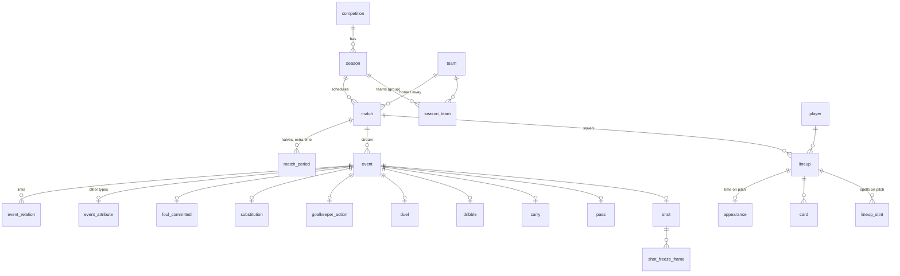

# The canonical model

Built by `make model` from `raw.source_file`, in one transaction, in about 16 seconds.
If any constraint fails, the previous model stays in place.

```
raw.source_file ──► stg.* (one jsonb row per record) ──► model.* (typed, constrained)
                                  └──► stg.quarantine (impossible records, with reasons)
```

## Tables and grain



| Table | One row is |
|---|---|
| `competition` | a competition, e.g. the FIFA World Cup, across all its seasons |
| `season` | a competition season. The key is `(competition_id, season_id)` because StatsBomb reuses `season_id` 106 for two competitions |
| `season_team` | a team in a competition season, with its group |
| `team`, `player`, `manager`, `stadium`, `referee` | one entity each |
| `match` | a match. Scores include extra time and exclude shootouts |
| `lineup` | a player in a team's matchday squad, unused substitutes included |
| `lineup_stint` | a continuous spell a player spends in one position (positions only; see below) |
| `appearance` | a player who took the field: when they came on and went off, and seconds played, all from the event stream |
| `match_period` | a period played (1–4) with its real duration, stoppage time included |
| `card` | a card shown to a player |
| `event` | an on-ball event: its common attributes, plus lookups for type, play pattern and position |
| `shot`, `pass`, `carry`, `dribble`, `duel`, `goalkeeper_action`, `substitution`, `foul_committed` | one event of that type (`event_id` is both the primary key and a foreign key) |
| `shot_freeze_frame` | a player visible at the moment of a shot |
| `event_attribute` | an event of a type without its own table, with its type-specific object kept as jsonb |
| `event_relation` | a directed link between two events |

## Decisions

- **Supertype/subtype tables for events.** Each event's common columns live in one
  table, and each type has its own table, joined 1:1 on `event_id`. The alternatives
  were rejected: one wide table would have 100+ mostly-NULL columns, and keeping
  everything in jsonb would leave nothing typed or constrained.
- **Rarely-used types stay as jsonb** in `event_attribute`, so no attribute is lost. A
  type gets its own table when an analysis needs it. A test fails if any attribute of
  a modelled type isn't mapped to a column.
- **Lookup tables for the id/name pairs on every event** (`event_type`, `play_pattern`,
  `position`). Attributes local to one type, such as shot outcome or pass height, stay
  as their names. Lookup tables for these would add joins without adding integrity.
- **Clock strings are parsed to seconds.** StatsBomb writes `'105:00'`, which no
  `time` type accepts.
- **Impossible records are quarantined, never silently dropped or "fixed".**
  `stg.quarantine` keeps each one's payload and reason. A test pins the known list, so
  any new anomaly fails the build.
- **Time on the pitch comes from the event stream, not lineup positions.** StatsBomb's
  lineup positions contain phantom spells. `appearance` is built
  from the Starting XI, Substitution and red-card events and the Half End times. It is
  tested against the rules of the game: each team must have 11 players on the pitch,
  minus dismissals, at the start, middle and last second of every period. The expected
  dismissals come from the lineup card records, an independent source.
- **Booleans that StatsBomb omits when false** become `NOT NULL DEFAULT false`.

## Problems found in the source data (all caught by tests)

| Problem | How it's handled |
|---|---|
| openfootball stores the score in two shapes; 7 matches use a bare `[h, a]` | Both shapes are parsed; a test fails on a third shape |
| Morocco's group label is empty in all three of its group matches | The group is inferred from its group-stage opponents; a test requires 8 groups of 4 |
| 4 players are spelled two ways under one `player_id`; nicknames and countries vary across matches too | Each attribute is chosen separately: its most frequent value, with ties going to the latest match date |
| 95 phantom lineup stints across 30 matches, of four kinds: 20 end before they start, 28 "end" with the same player coming on, 25 overlap another spell of the same player, 22 put a substitute on the pitch before their entry. 51 of them are in the 5 extra-time matches (late Tactical Shifts); most of the rest are zero-length spells at half-time substitutions | Quarantined under these four named reasons, with the count for each pinned by a test. Time on the pitch is taken from the event stream instead (`appearance`). Rebuilding positions from Tactical Shift events is future work |
| One match has no referee | `referee_id` is nullable |

## How the review changed the model

An independent review agent ran before the phase was closed. It found that the first
version quarantined only one kind of phantom stint, and that two tests passed
because of how the table was built rather than because the data was right. Both tests
were replaced with checks against the rules of the game. Each new check was then
mutation-tested: it must fail when, for example, red cards are ignored.

## Checked against published reality

- Goals derived from the model equal the published score of all 64 matches, and
  equal the raw-level audit derivation.
- Top scorers equal FIFA's Golden Boot: Mbappé 8, Messi 7, Álvarez 4, Giroud 4.
- All 8 group tables, derived from match results and ranked by points, then goal
  difference, then goals scored, equal the published final standings for all 32 teams.
